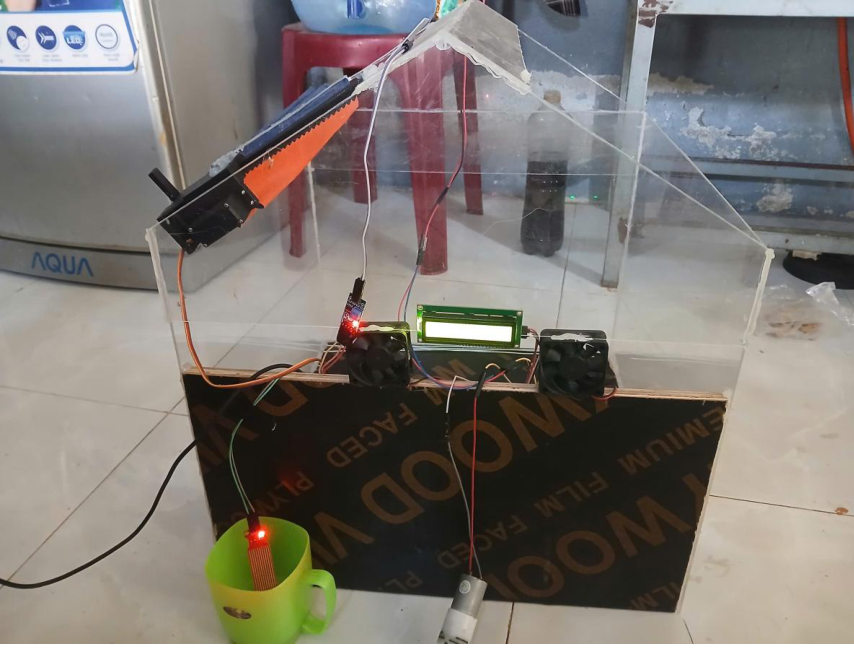
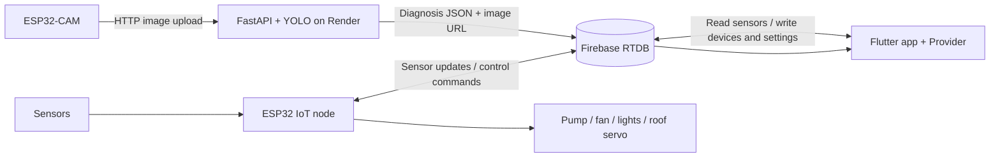
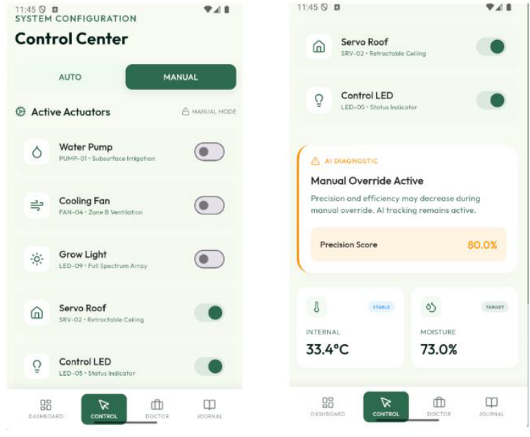

# Smart Farm — AIoT Tomato Monitoring & Disease Detection

> Academic smart-farming prototype integrating ESP32-based environment monitoring, automated actuators, cloud AI inference, and a Flutter dashboard.

**Stack:** ESP32 · ESP32-CAM · Arduino/C++ · Firebase Realtime Database · Python/FastAPI · YOLO · Render · Flutter · Provider

## Overview

The system monitors a small tomato-farm model and supports manual/automatic control of actuators. Camera images are sent to a **cloud-hosted AI API** for tomato and disease recognition. Sensor readings, device states, and AI diagnosis results are synchronized through Firebase Realtime Database for viewing in a Flutter app.

## Features

- Environment monitoring with temperature/humidity, soil moisture, gas, ambient light, rain, and water-level sensors (according to the academic prototype design).
- Relay-controlled pump, fan and lighting, plus a servo-operated roof.
- Automatic mode with manual override from the mobile app.
- ESP32-CAM image upload to a Python/FastAPI YOLO inference service deployed on Render.
- Bounding-box images, diagnosis details, and treatment/harvest guidance displayed in the app.
- Real-time dashboard and device control via Firebase Realtime Database.
- Local diagnostic history with timestamp-based duplicate prevention, implemented using Flutter `shared_preferences` and Provider.

## Architecture

### Data model (simplified)

| Firebase node | Purpose |
| --- | --- |
| `sensors` | Environmental measurements such as `temp`, `gas`, `light`, `rain`, `soil`, `water` |
| `devices` | Current/commanded actuator state such as `pump`, `fan`, `led`, `roof` |
| `settings` | Automatic vs. manual operation, including the `auto` flag |
| `tomato_status` | AI diagnosis, image URL, update timestamp and suggested actions |

## Screenshots and prototype

The course report documents integration tests of sensors, actuators, Firebase, the Flutter app, and the AI API. It also discusses an uneven dataset and weaker performance on leaf-disease classes; **do not interpret this prototype as a validated agricultural diagnostic device**.

## Deployment and configuration

This project has **three separately configured parts**:

1. **Firmware:** Flash the ESP32/ESP32-CAM sketches with appropriate board settings, GPIO/pin mapping, Wi-Fi, and Firebase configuration, using the firmware files actually present in the repository.
2. **Cloud inference:** Install the Python requirements and start the FastAPI application using the entry point defined in the repository. Supply the trained YOLO weights and required environment variables; deploy to Render only when the endpoint and dependencies have been verified.
3. **Mobile:** Configure FlutterFire/Firebase access, run `flutter pub get`, then `flutter run` from the actual Flutter project directory.

**Do not commit** Firebase credentials, Wi-Fi passwords, service-account keys, or production URLs containing secrets. Exact commands and paths depend on the checked-out source structure; verify them before publishing a reproducible quick start.

## Known limitations

- Leaf-disease detection was less accurate than some other classes; the report highlights background interference and class similarity.
- Reliance on internet connectivity for cloud inference.
- Educational-scale pumps/servos and DHT11 sensors do not represent industrial precision.
- The evaluation test split in the report was small, so accuracy figures should not be generalized.

## Academic context

PBL5 — Computer Engineering Project, Da Nang University of Science and Technology (DUT), June 2026. Team project documented in the supplied course report; this README does not assign individual ownership of components.

## 📄 Documentation

For detailed system architecture, hardware design,
implementation, and experimental results:

📘 [Full Project Report (PDF)](docs/PBL5.pdf)
